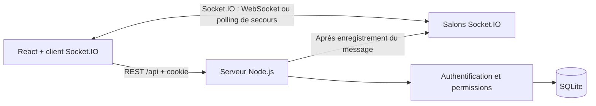

# Relay — Messagerie collaborative

**Application de messagerie de groupe full-stack**, construite avec React, Node.js et SQLite. Relay permet de créer un compte, d'ouvrir un groupe de discussion, d'y inviter des membres et d'échanger des messages dans une interface responsive.

> **Statut :** projet de démonstration / portfolio. Les messages sont transmis **en temps réel avec Socket.IO** (WebSocket lorsque disponible, repli sur HTTP long-polling). L’API REST et SQLite restent la source de vérité. **Les tests WebSocket et le build frontend s’exécutent dans la CI une fois les dépendances npm installées.**

## Fonctionnalités

- Inscription, connexion, déconnexion et maintien de session après actualisation de la page.
- Hachage des mots de passe avec `scrypt`, sessions aléatoires stockées côté serveur sous forme de hash et cookies `HttpOnly` / `SameSite=Strict`.
- Création de groupes ; affichage des groupes dont l'utilisateur est membre.
- Invitation par adresse e-mail **d'un compte déjà inscrit**, retrait de membres, départ d'un groupe et suppression par son propriétaire.
- Messages horodatés avec auteur, pagination des anciens messages (50 par page), affichage par date et diffusion instantanée aux membres connectés.
- Interface adaptée à l'ordinateur et au mobile, gestion des états vides, chargements et erreurs.
- Vérification des permissions **dans l'API** (pas seulement dans les boutons de l'interface).
- Synchronisation après reconnexion : récupération de l’historique manqué via l’API REST, sans doublons d’affichage.
- Tests d’intégration automatisés REST et Socket.IO, workflow GitHub Actions.

## Aperçu

L'interface propose une liste de groupes, une conversation centrale et un panneau de gestion des membres. Un compte de démonstration et plusieurs messages d'exemple peuvent être initialisés localement.

L'interface comporte une colonne de conversations, une zone centrale pour les messages et un panneau de membres. Pour voir l'application en fonctionnement, utiliser les comptes de démonstration ci-dessous.

## Stack technique

| Couche | Technologies |
| --- | --- |
| Frontend | React 19, React Router 7, Vite 6, CSS responsive |
| Backend | Node.js 22.13+, Express non requis (HTTP natif + Socket.IO 4) |
| Temps réel | Socket.IO 4, salons par groupe, authentification par cookie de session |
| Base de données | SQLite, module natif `node:sqlite`, requêtes SQL paramétrées |
| Sécurité | `node:crypto` (scrypt, sessions), cookies protégés, contrôle des droits |
| Qualité | `node:test`, ESLint, GitHub Actions, Docker multi-stage |

> **Compatibilité :** ce projet utilise `node:sqlite` (API encore expérimentale sous Node.js 22, avec avertissement au démarrage). Utiliser **Node.js 22.13+**, de préférence 22.16+ ou une version 24 compatible. Pour un déploiement durable, surveiller la stabilité de cette API ou migrer vers un driver SQLite maintenu.

## Installation locale

Prérequis : **Node.js 22.13+** et npm, avec accès au registre npm lors de l’installation. Aucun service externe, clé API ni serveur de base de données n’est nécessaire.

Ouvrir **deux terminaux** à la racine du projet :

**Terminal 1 — API**

```bash
cd backend
npm install
npm run seed   # optionnel : crée les utilisateurs et messages de démonstration
npm run dev
```

**Terminal 2 — interface**

```bash
cd frontend
npm ci
npm run dev
```

Ouvrir **http://127.0.0.1:5173** dans le navigateur. L’interface Vite redirige `/api` **et** `/socket.io` (requêtes HTTP et WebSocket) vers le serveur Node local, qui écoute sur le port 3000. Le client Socket.IO est servi par le backend, sans CDN externe.

### Tester la démo

Après `npm run seed` dans `backend`, vous pouvez vous connecter avec :

| E-mail | Mot de passe |
| --- | --- |
| `alice@example.test` | `Demo1234!X` |
| `bob@example.test` | `Demo1234!X` |
| `charlie@example.test` | `Demo1234!X` |

Alice est propriétaire du groupe « Projet Web — équipe démo ». Bob et Charlie en sont membres. **Pour vérifier le temps réel**, ouvrez Alice et Bob dans deux profils de navigateur distincts, puis envoyez un message : il apparaît immédiatement dans l’autre fenêtre sans actualiser. Les comptes de démonstration sont **réservés à une installation locale ou isolée** et ne doivent pas être créés dans un environnement public.

Pour repartir d'une base vide, **arrêter l'API**, puis supprimer `backend/data/relay.sqlite` et les éventuels fichiers `-wal` / `-shm`. La base et les tables seront créées automatiquement au démarrage. Le lancement normal **ne supprime jamais les données existantes**.

### Vérifier le projet

```bash
cd backend
npm install
npm test

cd ../frontend
npm run lint
npm run build
```

`npm test` lance les tests HTTP et les scénarios Socket.IO (authentification WebSocket, réception entre deux comptes, ajout et retrait des membres, déconnexion et rattrapage via REST). Les bases utilisées sont temporaires ou en mémoire ; votre base locale n’est pas modifiée. Le frontend requiert au préalable `npm ci`.

## Architecture




```text
relay-messenger/
├── frontend/
│   ├── src/components/         # UI réutilisable : avatars, icônes, modale
│   ├── src/lib/                # Client HTTP et contexte d’authentification
│   ├── src/pages/              # Authentification et conversations
│   └── src/index.css           # Design responsive
├── backend/
│   ├── src/app.js              # Routes HTTP, validation, permissions, diffusion
│   ├── src/realtime.js         # Socket.IO : rooms, session, événements
│   ├── src/db.js               # Schéma SQLite et transactions
│   ├── src/security.js         # Mots de passe et sessions
│   ├── src/seed.js             # Données de démonstration opt-in
│   ├── test/api.test.js        # Tests API end-to-end
│   └── test/realtime.test.js   # Tests multi-clients Socket.IO
├── docs/API.md                 # Référence des routes
├── .github/workflows/ci.yml   # Tests, lint et build sur chaque push / PR
└── Dockerfile
```

Les événements Socket.IO sont **en lecture seule côté client** : l'envoi d'un message passe toujours par `POST /api/groups/:id/messages`, avec contrôle des droits et insertion en SQLite. Le serveur diffuse ensuite `message:new` dans le salon du groupe. À la connexion, le serveur authentifie le cookie HttpOnly puis rejoint automatiquement les groupes dont l'utilisateur est membre. L'ajout ou la suppression d'un membre met à jour ses salons immédiatement, et la déconnexion invalide aussi les sockets de la session.

En cas de coupure, Socket.IO se reconnecte automatiquement et le frontend récupère les derniers messages via REST. Les messages sont dédupliqués par identifiant. **Limite :** le rattrapage de l'interface utilise les 50 messages les plus récents (pour de très longues coupures ou de très forts volumes, ajouter une API de synchronisation `after`).

Le modèle relationnel comporte cinq tables : `users`, `sessions`, `groups`, `memberships` et `messages`. Un message est associé à son **auteur** et à son **groupe**. La table de liaison `memberships` distingue `owner` et `member`.

## Documentation API

La liste complète des routes et des événements en temps réel, leurs corps JSON et les droits d’accès sont disponibles dans [docs/API.md](docs/API.md). Exemple :

```http
POST /api/groups/1/messages
Content-Type: application/json
Cookie: relay_session=<session>

{"body":"Bonjour à tous !"}
```

## Déploiement

Après compilation, l'API Node.js peut également servir le frontend généré :

```bash
cd frontend
npm ci
npm run build
cd ../backend
npm install
npm start
```

Ouvrir ensuite **http://localhost:3000** (il n'est plus nécessaire de lancer Vite). Pour une installation distante, configurer **HTTPS** devant Node, `NODE_ENV=production`, `DB_PATH` vers un dossier persistant et l'accès réseau approprié.

Une image Docker multi-stage est également fournie. Pour retrouver les comptes de démonstration, initialisez le volume **avant** le premier démarrage :

```bash
docker build -t relay-messenger .
docker run --rm -v relay-data:/app/backend/data relay-messenger node backend/src/seed.js
docker run --rm -p 3000:3000 -v relay-data:/app/backend/data relay-messenger
```

Le serveur et l'interface seront disponibles à **http://localhost:3000**. Le volume nommé `relay-data` persiste lorsque le conteneur est supprimé ; l'étape `seed.js` est facultative et réservée à la démo locale.

**Ne pas exécuter `npm run seed` en production**. Un conteneur sans volume persistant perdrait ses messages lors d'une recréation. GitHub Pages ne suffit pas pour héberger cette application : l'API et la base de données doivent aussi tourner sur un serveur.
